# 🌙 Lunabria (PWA Everywhere)

[](LICENSE)
[](https://python.org)
[](https://calibre-ebook.com)
[](docs/architecture.md)
[](#3-offline-reading-pwa--outbox-sync)
[](#5-start-caddy-reverse-proxy-with-http2-support)

**Lunabria** is a modern, self-hosted reading platform and personal library workstation connected directly to your existing Calibre library. Accessible from any modern browser and installable on all your devices (desktop, tablet, smartphone) as an **offline-capable Progressive Web App (PWA)** with **HTTP/2** multiplexed streaming.

Lunabria bridges the gap between Calibre library management and deep, distraction-free study: sub-glyph text selection, semantic multi-color highlight categories, pressure-sensitive digital inking with palm rejection, touch-optimized mobile navigation with hold-to-select magnifying loupe, and deterministic notes export designed for Obsidian, Logseq, and Personal Knowledge Management (PKM) workflows.

> [!IMPORTANT]
> **Copyright & Content Policy**: Lunabria is an open-source, self-hosted reading platform and personal library manager. All book titles, covers, and excerpts shown in the screenshots, demo fixtures, and documentation are strictly works in the **public domain** (courtesy of Project Gutenberg and open archives). Lunabria does **not** host, distribute, or bundle copyrighted books. Users must not share or distribute copyrighted materials without appropriate authorization, and are solely responsible for ensuring that all files in their personal Calibre libraries comply with applicable intellectual property laws.

---

## 🎯 Target Audience

Lunabria is intentionally designed for:

- 🏠 **Homelab Self-Hosters**: Users who already curate their Calibre libraries and want zero-copy reading on their local network or homelab (Raspberry Pi, mini PC, or VPS) with low resource consumption, direct CLI integration, and robust HTTP/2 streaming.
- 🎓 **Active Readers & Researchers**: Students, academics, and non-fiction readers who require deep annotation, customizable semantic highlights (*Key Idea*, *Definition*, *Question*, *Quote*), chapter-aware table of contents navigation, and clean Markdown export to Obsidian, Logseq, or Notion.
- ✍️ **Tablet & Stylus Users**: Readers on iPads (Apple Pencil), Microsoft Surface (Surface Pen), or Android tablets who want real-time digital inking, margin sketching, freehand highlighter blending, and hardware-tailored palm rejection.
- 📱 **Everyday Mobile Readers**: Anyone who wants to continue reading on their phone with an installable PWA, seamless offline caching, a dedicated circular magnifying loupe for thumb-precision text selection, and AMOLED black theme.

---

## 📸 Screenshots & UI Showcase

### Library Control Center & Continue Reading
Adaptive paginated book grid, virtual library filters, live reading progress indicators, and lunar branding insignia.

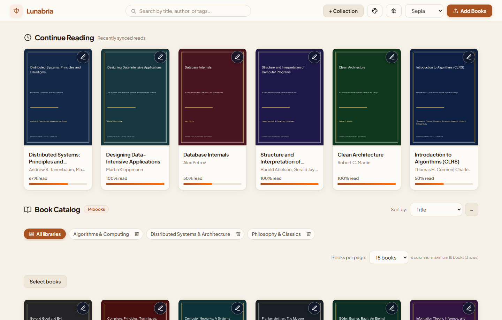

---

### PDF Reader & Real-Time Highlights
Ergonomic reading interface with full sub-glyph text layer selection, page scrubber, and digital stylus support.

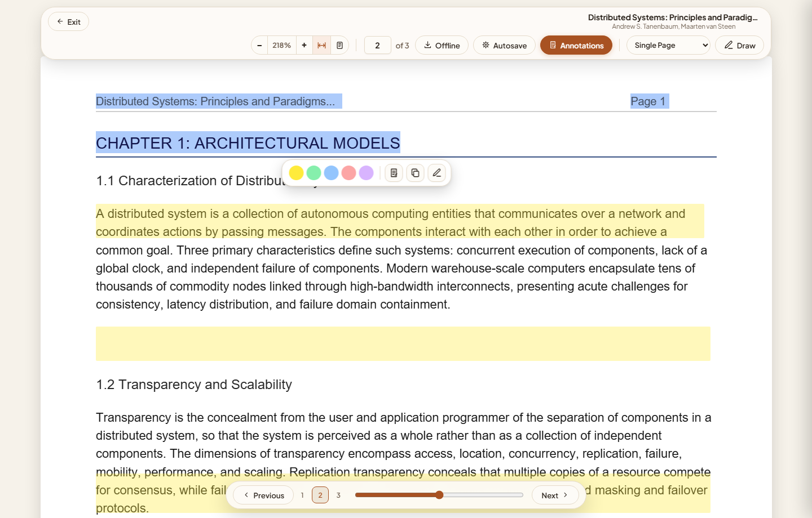

---

### Customizable Highlight Palette & Semantic Labels
Personalized color palette with custom semantic categories (*Key Idea*, *Definition*, *Reference*, *Question / Important*, *Quote*).

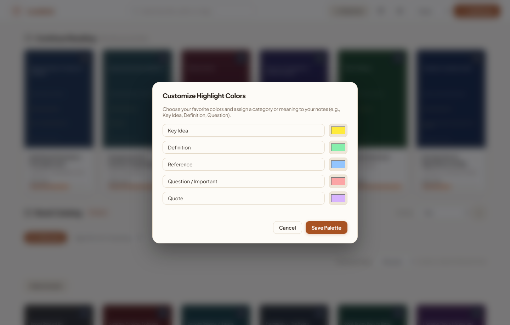

---

### Calibre Metadata Editor & Online Assistant
In-app metadata editor connected to Calibre CLI with ISBN auto-fetch, tag editor, and cover artwork preview.

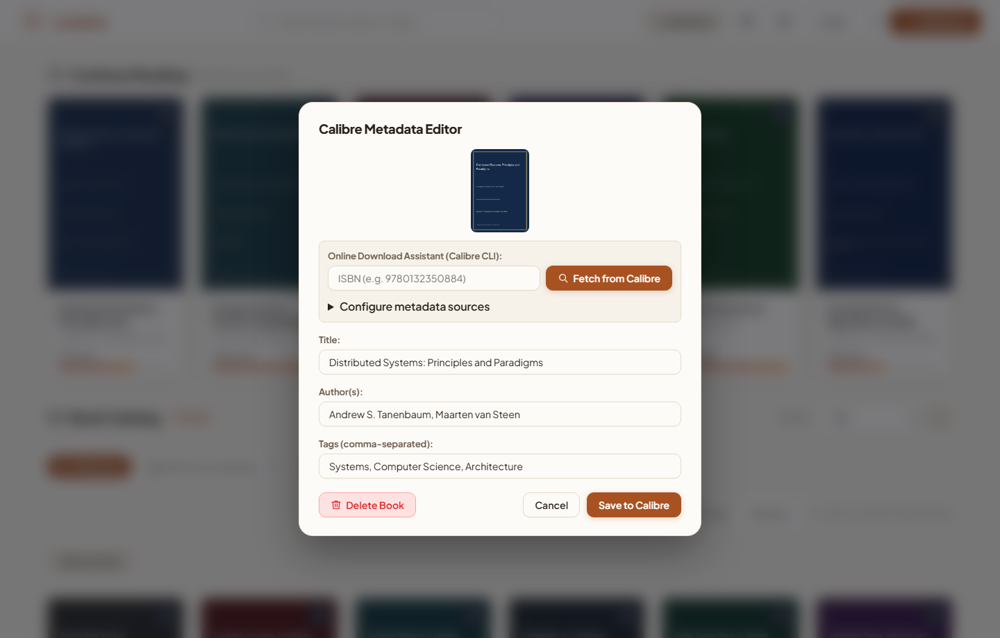

---

### Slide-Out Annotations Drawer & Multi-Format Export
Interactive lateral notes drawer with real-time color filtering and deterministic export to Markdown, JSON, JSONL, YAML, and TOML.

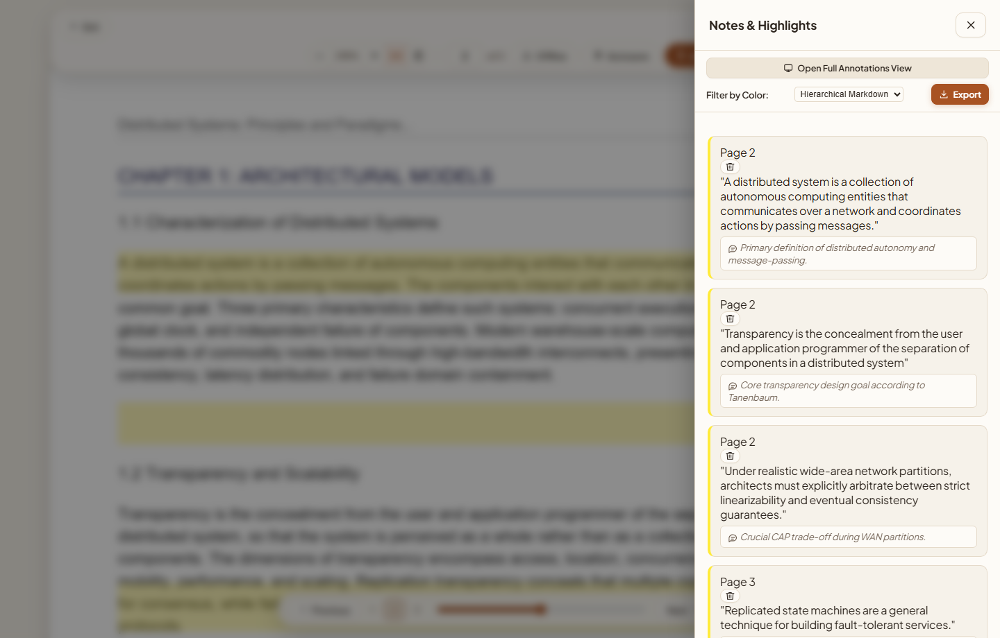

---

### Full-Screen Annotations Notebook
Dedicated editorial study view organizing quotes, personal notes, and chapter reflections.

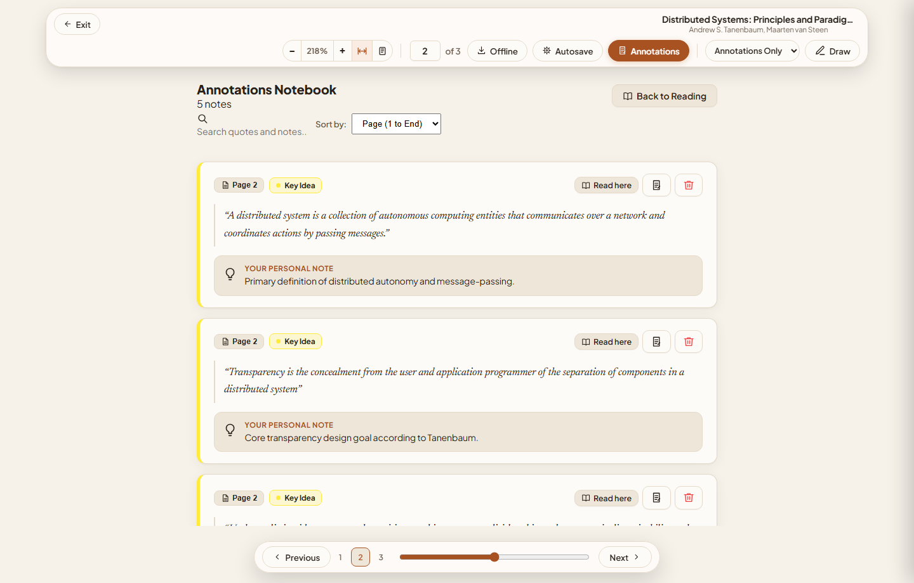

---

### Freehand Stylus Drawing & Smart Pencil Toolbar
Integrated drawing canvas with pressure sensitivity, customizable pen colors, highlighter mode, and instant sync.

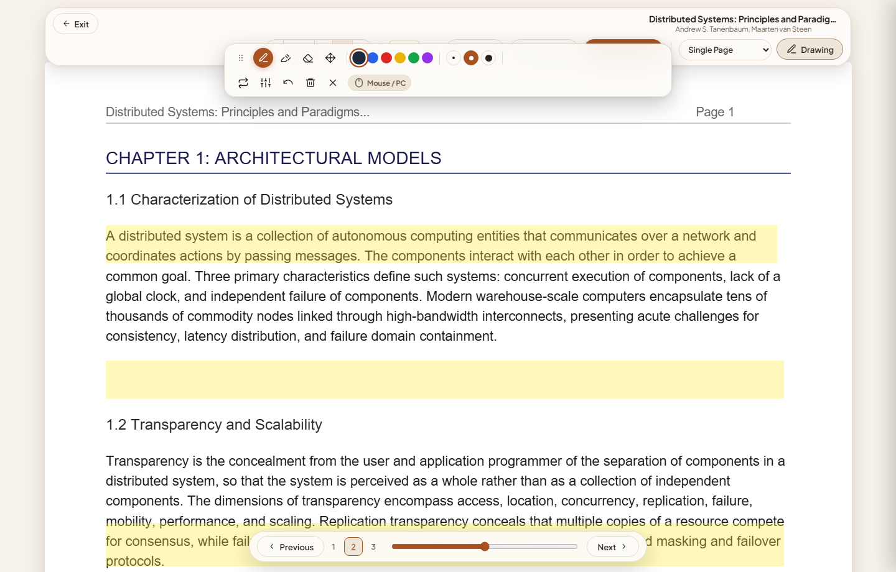

---

### Stylus Hardware & Palm Rejection Settings
Tailored stylus interactions with strict palm rejection, double-tap pen/highlighter toggle, and custom pressure dynamics.

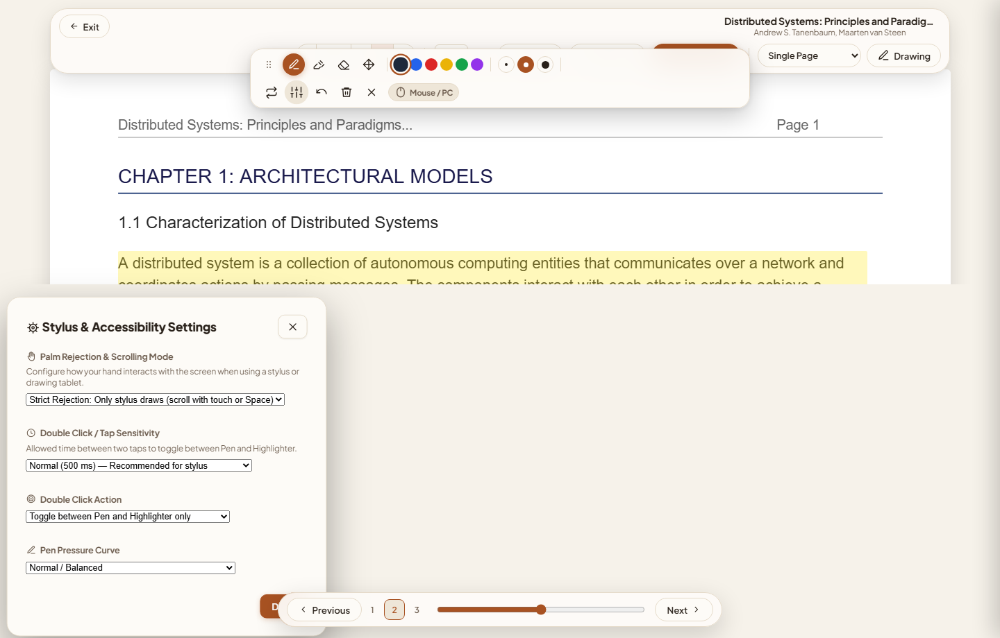

---

### Virtual Libraries & Dynamic Collection Management
Organize extensive collections effortlessly using Calibre-native tag queries, regular expressions, or manual curated selections without file duplication.

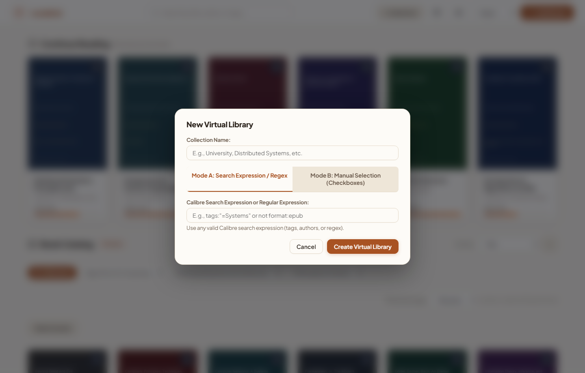

---

### Ergonomic Reading Themes & AMOLED Black Mode
Multiple eye-care themes including Sepia and true OLED `#000000` AMOLED Black for distraction-free night reading and battery conservation.

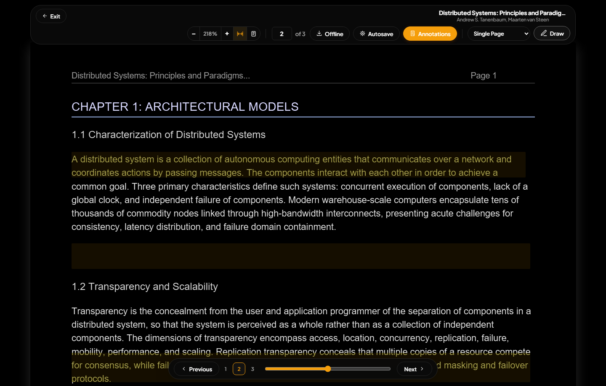

---

### PWA Offline Storage & Autosave Outbox Engine
Dedicated sync manager with storage quotas, offline cache controls, and background outbox sync ensuring zero data loss across disconnected sessions.

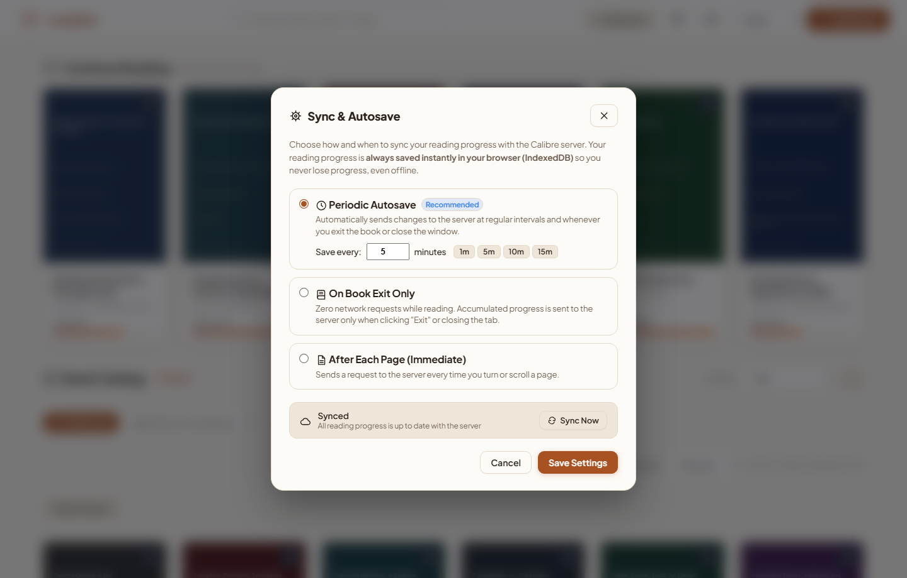

---

### Mobile Touch Reader & Circular Magnifying Loupe
Tailored mobile touch reading experience featuring a single-row compact topbar, floating action button (FAB), and hold-to-select circular magnifying loupe for precision thumb navigation.

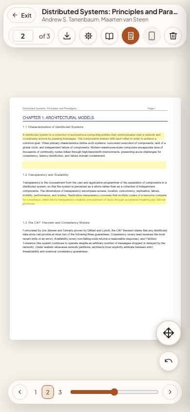

---

## 🌟 Key Features

### 1. Library Control Center (Home)
- **"Continue Reading" Carousel:** Instantly resume your **10 most recently read books** with real-time progress bars, completion percentage, and current page.
- **Adaptive Paginated Catalog:** Dynamic grid view that scales gracefully with your viewport width, supporting custom page sizes, responsive column layouts, and local cover caching.
- **Virtual Library Switcher:** Filter your book collection without duplicating files, with cover cards, live Calibre query previews, preselected search/collection matches, and quick select/deselect controls.
- **Batch Book Management:** Select multiple books from search results or the catalog to group them into manual virtual collections or remove them directly from the active collection.
- **Universal Live Search:** Instant filtering supporting multi-word queries, symbolic and natural-language boolean operators (`+` / `and`, `,` / `or`, `-` / `not`), parentheses grouping, exact quote matching (`"..."`), and targeted prefixes across titles, authors, publishers, and Calibre tags.
- **Local Cover Caching & Vector Fallback:** Book covers viewed in the library are cached locally in IndexedDB for instant retrieval and offline reuse; books without an embedded cover fall back seamlessly to an offline vector cover.
- **Reconnection Detection:** Automatically detects when a dropped connection is restored, refreshing the catalog and syncing queued reading progress.
- **Ergonomic Themes:** **Sepia** (warm daylight tone), **AMOLED Black** (pure `#000000` for OLED displays), and **Dark** (slate).
- **Brand Identity & PWA Installation:** Open-book lunar brand insignia, dynamic SVG favicon, and maskable touch icons for mobile home-screen installation.

### 2. Reading Workstation & Digital Inking
- **Universal Sub-Glyph Text Selection:** Initiate selections smoothly from page margins, paragraph padding, or between lines with edge-to-edge word expansion on double-click drag and collision-avoiding floating HUD placement.
- **Contextual Floating Menu:** Select text to reveal quick action controls: highlight color palette, notes, and clipboard copy.
- **Reader Navigation:** Browse a book's table of contents, choose continuous one-page or two-page reading in the desktop browser, follow internal PDF links and matching chapter or section references, then return to your previous reading position.
- **Customizable Semantic Highlight Taxonomy:** Freely configure your own colors and semantic labels (e.g., *Key Idea*, *Definition*, *Question*, *Quote*).
- **Freehand Stylus & Digital Inking:** Draw notes, margin diagrams, underlines, and freehand highlights directly on book pages with pressure dynamics, palm rejection, and dedicated hardware settings.
- **Slide-Out Lateral Drawer:** Chronologically lists all highlights, annotations, and notes with interactive color filtering.
- **Deterministic Multi-Format PKM Export:** Export all annotations, a chapter/section, a page range, or individually selected annotations to **Hierarchical Markdown**, **Markdown grouped by color/page**, **JSON**, **JSONL**, **YAML**, and **TOML** from desktop or mobile.
- **Dedicated Mobile & Touch Reader:** Tailored mobile reading interface featuring a compact single-row topbar, a collapsible Floating Action Button (FAB) for drawing and quick color selection, long-press text selection with a circular magnifying loupe, and a one-tap page stroke wipe button.
- **Precision Zoom & Ergonomic Navigation:** Dedicated **Fit-to-Width** (`W`), **Fit-to-Page** (`H`), and **Actual Size (1:1 / 100%)** (`Ctrl+0`) modes. Smooth **Ctrl + Wheel** and continuous trackpad/touchscreen pinch-to-zoom with real-time GPU preview and dynamic velocity scaling across an expanded range from **25% to 500%**.
- **Fault-Tolerant Rendering:** If a PDF page canvas render encounters an issue, a recoverable error card with an inline retry button displays instead of an unrecoverable blank page.
- **On-Demand Format Conversion:** If a book has no PDF, an available format supported by Calibre (such as EPUB) is automatically converted to PDF when opened and cached without altering the original library files.

### 3. Offline Reading (PWA) & Outbox Sync
- **Full Offline PWA:** Cached books appear in the library immediately on startup without network timeouts. Download books, their cover art, and pre-buffered page layouts into IndexedDB.
- **Offline Banner:** Clear indicator communicating connectivity status and the number of books available offline.
- **Persistent Outbox Annotation Sync:** Highlights, notes, freehand drawings, and reading progress created without a connection are queued locally in an outbox and synchronize automatically once network access returns.
- **In-App Update Notification:** In-app banner alerts readers whenever an updated version of the application is available for one-click reload.

### 4. Book Ingestion & Calibre Metadata Management
- **Asynchronous Book Ingestion:** Import books through a compact dropzone; uploads and Calibre processing continue in the background with live progress in a dock while you browse, search, or read.
- **Duplicate ISBN Protection:** Get a confirmation before adding a book with an existing ISBN and format; different formats remain allowed.
- **Automatic Metadata Priority Cascade:** Background ingestion searches online metadata using document ISBN, PDF title, then cleaned filename, while preserving uploaded details if no match is found.
- **Calibre Metadata Editor:** Modify title, authors, tags, series, series index, and synopsis directly.
- **Online Metadata Assistant:** Runs Calibre CLI (`fetch-ebook-metadata`) to scrape summaries and high-resolution book covers from Google Books, Open Library, Amazon, and Goodreads.
- **Direct Library Integration:** Commits metadata updates safely to Calibre's `metadata.db` via `calibredb set_metadata`.

---

## 📚 Virtual Libraries & Collections

- **Universal Query Engine:** Combine symbolic and natural-language logical operators (`+` / `and`, `,` / `or`, `-` / `not`), parentheses grouping, exact quote matching (`"..."`), and field-directed queries (`tags:`, `author:`, `publisher:`, `title:`) across live search and collection rules with automatic Calibre syntax compilation.
- **Optional Visual Query Builder:** Collapsible query builder modal with tactile operator chips and live Calibre expression preview for intuitive rule construction.
- **Hybrid Collections:** Seamlessly unite automatic search rules with manual book additions and explicit book exclusions; search the catalog to add books directly to an existing collection.
- **Collection Management Dialog:** Rename virtual libraries and manage book memberships directly, edit rules with removable query tokens and a live Calibre preview, and use quick-edit collection badges in the library catalog.
- **Zero Disk Duplication:** No physical files are moved or duplicated.

---

## ⚠️ Important Considerations & Calibre Prerequisites

Lunabria interfaces directly with your Calibre library and CLI utilities. Keep the following external requirements and Calibre behavioral details in mind:

> [!WARNING]
> **Calibre Desktop Concurrency & Database Locks**:
> Calibre maintains an exclusive lock on `metadata.db` while running. If the Calibre desktop application (`calibre.exe`) or `calibre-server` is open, write operations from Lunabria (such as uploading new books or saving metadata updates via `calibredb`) will return a conflict error.
> **Recommendation:** Keep desktop Calibre closed when uploading books or modifying metadata in Lunabria. Browsing, streaming, and reading existing books remain fully functional regardless.

> [!NOTE]
> **Library Path Length on Windows (< 75 characters)**:
> Calibre's Windows backend enforces a legacy constraint requiring library paths to be shorter than 75 characters. Avoid placing your library inside deep nested user folders (e.g., `AppData\Local\...` or nested OneDrive folders). Keep library paths compact (e.g., `C:\Calibre Library` or relative project paths like `./data/calibre_library`).

> [!TIP]
> **Cloud Storage & Network Drives**:
> Following official Calibre project guidance, avoid hosting your active `CALIBRE_LIBRARY_PATH` directly inside real-time cloud-sync folders (Google Drive, OneDrive, Dropbox) or unbuffered SMB/NFS network shares, as concurrent sync activity can trigger SQLite locking anomalies or database corruption.

> [!IMPORTANT]
> **Calibre CLI in System PATH**:
> Lunabria uses Calibre CLI binaries (`calibredb`, `ebook-convert`, `fetch-ebook-metadata`) for library indexing, format conversion, and online metadata retrieval. Make sure Calibre is installed on your host system and accessible in your `PATH`, or specify their custom binary paths in your `.env` configuration file.

---

## 🔍 Known Issues & Typography Limitations

For a detailed technical overview of book compatibility edge cases—such as scanned books without OCR, custom font ligatures, monospaced code blocks, or temporary layout desyncs (and their workarounds)—please consult:

👉 **[Docs: Known Issues & Typography Limitations](docs/known_issues.md)**

---

## 🖥️ Run on a Windows Desktop

1. Install Python 3.11 or later and Calibre for Windows. Make sure `calibredb`, `ebook-convert`, and `fetch-ebook-metadata` are available in `PATH`.
2. Create a `.env` file in the repository root and point it to your Calibre library. For a local-only desktop instance, use:

   ```dotenv
   CALIBRE_LIBRARY_PATH=C:\Calibre Library
   APP_DATA_DIR=.\data
   HOST=127.0.0.1
   PORT=8000
   ```

   Keep the Calibre library path under 75 characters and outside cloud-synced or network folders. If you omit `CALIBRE_LIBRARY_PATH`, Lunabria uses `data/calibre_library`. If Calibre's command-line tools are not in `PATH`, set `CALIBREDB_BIN`, `EBOOK_CONVERT_BIN`, and `FETCH_METADATA_BIN` to their executable paths in `.env`.
3. In PowerShell, from the repository root, install the runtime packages and start Lunabria:

   ```powershell
   Set-Location backend
   py -3 -m venv .venv
   .\.venv\Scripts\python.exe -m pip install -r requirements.txt
   .\.venv\Scripts\python.exe run.py
   ```

4. Open `http://localhost:8000` in Edge, Chrome, or another modern browser. You can install Lunabria as a desktop app from the browser's install-app menu. Leave the terminal running while using the app; press `Ctrl+C` to stop it.

Close the Calibre desktop application before uploading books or saving metadata, since Calibre locks its library database while open.

---

## 🐧 Server Deployment (Linux / systemd / Caddy)

1. **Install Calibre and system dependencies:**
   ```bash
   sudo apt update
   sudo apt install -y calibre python3-venv python3-pip caddy
   ```

2. **Prepare the project environment:**
   ```bash
   cd backend
   python3 -m venv .venv
   ./.venv/bin/pip install -r requirements.txt
   cd ..
   ```

3. **Configure environment variables:**
   ```bash
   cp .env.example .env
   ```
   Key environment variables:
   ```bash
   CALIBRE_LIBRARY_PATH=./data/calibre_library
   APP_DATA_DIR=./data
   HOST=0.0.0.0
   PORT=8000
   ```

4. **Enable the systemd service:**
   Run the automated installer (detects the current directory and user):
   ```bash
   bash systemd/install.sh
   ```
   If the repository is on `/mnt/c` and its `.venv` is a Windows environment, create a Linux virtual environment and pass it with `LUNABRIA_VENV`:
   ```bash
   python3 -m venv "$HOME/.venvs/lunabria"
   "$HOME/.venvs/lunabria/bin/pip" install -r backend/requirements.txt
   LUNABRIA_VENV="$HOME/.venvs/lunabria" bash systemd/install.sh
   ```
   *Or configure manually by copying `systemd/lunabria.service` to `/etc/systemd/system/` with your absolute paths.*

5. **Start Caddy Reverse Proxy (with HTTP/2 support):**
   ```bash
   sudo cp caddy/Caddyfile /etc/caddy/Caddyfile
   sudo systemctl restart caddy
   ```

Once running, access the application locally at `http://localhost:8000` or through Caddy at `https://localhost:8443` (or `http://<SERVER-IP>:8085`).

---

## 🏛️ Architecture & Technical Documentation

For in-depth details on Lunabria's architectural design, modular contracts, and responsibility boundaries, refer to:

- [Architecture & Responsibilities Specification](docs/architecture.md)
- [Known Issues & Typography Limitations](docs/known_issues.md)

---

## 📜 Changelog

Release history and notable changes are documented in [CHANGELOG.md](CHANGELOG.md).

---

## 📄 License

This project is licensed under the **GNU Affero General Public License v3.0 (GNU AGPL v3)**. See the [LICENSE](LICENSE) file for the full license text.
