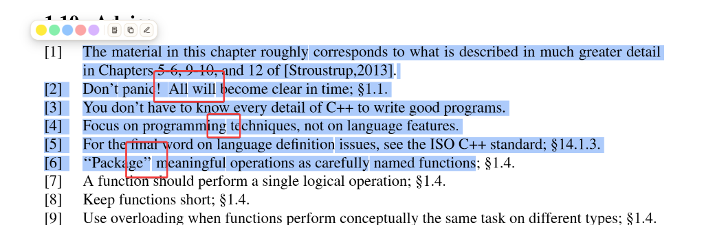
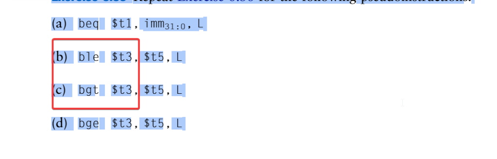

# 🔍 Known Issues & Typography Limitations

This document compiles technical constraints inherent to PDF typographic extraction, uncataloged fonts, scanned books, and layout synchronization nuances in the Lunabria reader.

---

## 📑 Index of Cases and Limitations

1. [Missing Text Layer (Scanned or Image-Based Books Without OCR)](#1-missing-text-layer-scanned-or-image-based-books-without-ocr)
2. [Complex Geometries, Asymmetric Kerning, and Problematic Glyphs](#2-complex-geometries-asymmetric-kerning-and-problematic-glyphs)
3. [Monospaced Fonts, Code Blocks, and Subscripts/Superscripts](#3-monospaced-fonts-code-blocks-and-subscriptssuperscripts)
4. [Trailing Whitespace and Line-Break Delimiters in Specific Formats](#4-trailing-whitespace-and-line-break-delimiters-in-specific-formats)
5. [Cross-Document Layout Synchronization Timing](#5-cross-document-layout-synchronization-timing)

---

### 1. Missing Text Layer (Scanned or Image-Based Books Without OCR)
* **Description:** Some books (primarily older digital scans, facsimiles, or PDFs consisting exclusively of compiled JPG/TIFF page images) lack an underlying vector text stream entirely.
* **Behavior in Lunabria:**
  * The reader renders pages with high visual fidelity via Canvas.
  * Text selection with the cursor and text-based semantic highlights ([`TextLayerView`](../frontend/js/views/reader/TextLayerView.js)) are unavailable because the PyMuPDF/PDF.js extraction engine cannot detect characters or text spans.
* **Workaround / Solution:**
  * Use the **stylus / freehand drawing mode** to write handwritten notes or highlight over the canvas with the graphical marker.
  * To enable native text selection and search, run an OCR tool such as `OCRmyPDF` on the file before importing it into Calibre.

---

### 2. Complex Geometries, Asymmetric Kerning, and Problematic Glyphs
* **Description:** Certain technical or academic publications use OpenType/Type 1 fonts with custom ligatures (`fi`, `fl`, `ff`), aggressive kerning pairs, or punctuation glyphs bound tightly to quotation marks (e.g., `“Package”`, `! All`, `ing te`).

* **Behavior in Lunabria:**
  * During text selection, minor subpixel separations or tiny jumps may appear between punctuation marks and adjacent words (as independent bounding boxes within `.precise-word`).
  * In fragments such as `! All` or `“Package”`, the boundary delimiter can produce a gap in the selection box because the PDF engine outputs the quotation mark or exclamation mark in a zero-width font block or with a distinct transformation matrix.
* **Impact:** This is a purely cosmetic artifact in the visual selection overlay (`::selection`). Text copied to the clipboard or saved in annotations preserves all characters accurately.

---

### 3. Monospaced Fonts, Code Blocks, and Subscripts/Superscripts
* **Description:** In code listings, assembly instructions (e.g., MIPS, C++, Python), or mathematical expressions with subscripts/superscripts (such as `$t1, imm_{31:0}, L`):

* **Behavior in Lunabria:**
  * Subscripts, superscripts, and control characters often have a vertical baseline ($y_0$) offset by several points relative to the main line of text.
  * PyMuPDF word separation may treat the subscript as an isolated micro-word, producing segmented per-token selection boxes instead of a single contiguous highlight bar.
* **Impact:** The visual highlight appears partitioned into individual rectangular boxes per token; however, text is extracted, normalized, and exported faithfully to Markdown.

---

### 4. Trailing Whitespace and Line-Break Delimiters in Specific Formats
* **Description:** In code listings containing long statements (e.g., lengthy HTTP endpoints like `GET /v1/health/service/{service_name}?passing=true`):

* **Behavior in Lunabria:**
  * When a PDF specifies a trailing space or line delimiter extending past the last visible glyph, a narrow vertical indicator may appear at the right boundary of the box.
* **Impact:** This preserves the line break or spacing delimiter so copied code blocks do not inadvertently merge consecutive lines without spaces.

---

### 5. Cross-Document Layout Synchronization Timing
* **Description:** In rare circumstances when rapidly switching between different books in the reader without reloading the browser tab, the viewer may momentarily display or cache the typographic layout (word coordinate stream) of the previous document over the pages of the newly opened document.
* **Root Cause:** Asynchronous page layout requests (`/api/books/{id}/pages/{page}/layout`) resolve with slight timing differences relative to PDF.js canvas rendering during rapid concurrent navigation.
* **Quick Workaround:**
  * **Zoom in or zoom out** (using the mouse wheel, `Ctrl + Scroll`, or the zoom buttons in the HUD): this invalidates the DOM tree of `TextLayerView`, cancels active rendering tasks, and triggers a clean recalculation of page geometries.
  * Alternating between paged view and continuous flow view also forces a layout reset.
